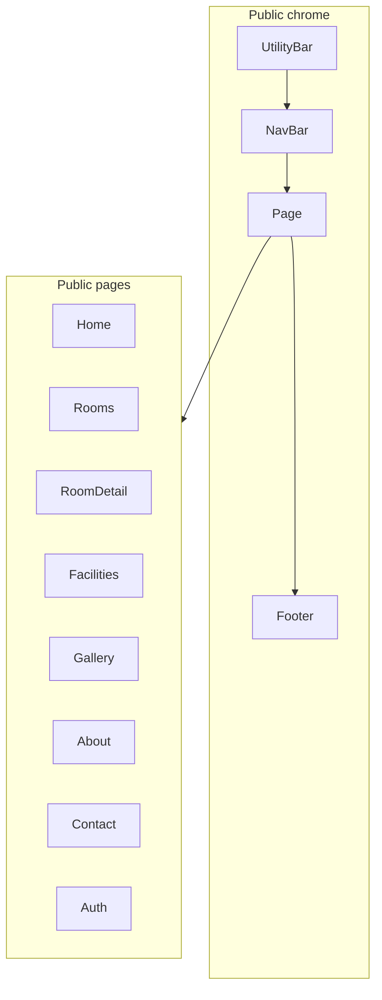

# Public showcase and production chrome

Design for taking Victorious Residence from an MVP shell to a production hostel site: a shared header and footer, hospitality-style public pages with placeholder photography, and the same visual system on the signed-in portals.

Inspiration is the **structure** of [cofkanshotelgh.com](http://cofkanshotelgh.com/) (utility bar, sticky nav, hero, photo room cards, amenity list, gallery, contact footer). Copy, amenities, and photos stay hostel-specific. Do not reuse Cofkans names, rates, address, or phone numbers. The seed address is only “Obuasi, Ghana”; contact lines stay clearly marked placeholders until management supplies real ones.

## What exists

- Home is a text column in `src/app/page.tsx`: headline, sign-in, and a live bed list. No header, footer, or photos.
- Login and register are narrow forms with a “back home” link.
- Signed-in areas share `src/components/portal-shell.tsx` plus button rows in the admin, manager, and resident navs. Every screen is stone borders on white, max width 5xl.
- Schema already has unused media fields in `src/server/db/schema.ts`: `residences.heroImageUrl`, `residence_media` (url, caption, sort order), `room_types.coverImageUrl`, and `room_types.amenities` (string list). No room gallery, no facility photos, no public phone/email.
- Room-type admin forms do not edit amenities or images.
- `cacheComponents: true` in `next.config.ts`. `/` and `/manager` fail because Neon’s client calls `crypto.getRandomValues()` during prerender. Public and portal data reads need `await connection()` from `next/server` before the first database call.

## Design system

One brand, two densities.

- **Public:** cream page (`#f6f1e8`), ink text (`#1c1917`), forest (`#1f3d32`), brass accent (`#8c6a3d`). Display face for headlines (Fraunces), Geist Sans for UI. Full-bleed photos, generous sections, sticky header.
- **Portals:** same colors and type, denser app chrome. Sidebar (desktop) / drawer (mobile) replaces the pill-button nav. Forms and tables stay functional; they are not restyled into marketing cards.
- Shared pieces: `SiteHeader`, `SiteFooter`, `RoomCard`, `PhotoGallery`, `AmenityList`, `AvailabilityBadge`.
- Header (public): thin utility strip (address, phone, email) and a sticky bar — wordmark, Rooms, Facilities, Gallery, About, Contact, Sign in, Apply for a bed. Signed-in visitors see “Open portal” instead of Sign in.
- Footer: the same links, placeholder contact, a one-line note that photos are stand-ins, and copyright.
- Portal header: wordmark, role label, current user, sign out, link back to the public site. Portal footer is a short legal/contact strip so the app does not end on a blank page.

## Public pages

Move the home page under `src/app/(public)/` so the marketing layout wraps it. Auth keeps its own layout but uses the same header and footer, with a split panel: photo on one side, form on the other.

- **Home:** hero (day exterior, name, short pitch, “View rooms” and “Apply for a bed”), three proof points (live beds, flexible room types, MoMo or bank proof reviewed by a manager), photo room cards with price per bed in GHS and an availability count, a facilities strip, a short gallery, and a closing CTA.
- **Rooms (`/rooms`):** list modeled on Cofkans’ rooms list. Each card: cover photo, name, one-paragraph description, capacity, price per bed, amenity chips, beds available, “More details”.
- **Room (`/rooms/[id]`):** 3-angle gallery, full description, amenity checklist, price, live availability. Guests go to register; signed-in residents go to the existing hold flow at `/resident/room-types/[id]`.
- **Facilities (`/facilities`):** one block per shared space, each with a photo and a short description.
- **Gallery (`/gallery`):** exterior and interior grid with captions.
- **About (`/about`):** who the residence is for, how a bed is held, and that payment is proof-based (not an instant hotel checkout).
- **Contact (`/contact`):** address, phone, email from the residence record, plus the apply / sign-in actions. No fake enquiry form in this pass.

Hostel facilities to show (not a hotel pool, jacuzzi, or conference package): shared kitchen, study room, lounge, laundry, secure entrance, and Wi-Fi common area.

Room copy stays the three seeded types, rewritten so a visitor can picture the room:

- Executive Single — private room, one bed
- Standard 2-in-1 — two bed spaces
- Economy 4-in-1 — four bed spaces

Each description lists what is in the room (bed, storage, desk, window, shared or private bath as appropriate) and points shared amenities to the facilities page. Prices stay the seeded GHS per-bed amounts.

## Placeholder photography

Generate photorealistic stand-ins into `public/showcase/`. Same building across shots: a modest 2–3 storey Ghana hostel, warm plaster, simple metal roof, not a luxury hotel. Captions say “Placeholder — replace with a site photo.”

- Exterior: front day, front night, entrance, compound or courtyard (4)
- Facilities: kitchen, study, lounge, laundry, gate or security desk, common area (6)
- Each room type: bed wall, second angle (desk or window), doorway or storage (9)

Replacement later is a same-filename swap, or an admin URL change.

## Data

Extend the schema instead of hardcoding the showcase:

- `residences.phone` and `residences.email` (nullable text)
- `residence_media.kind` (`EXTERIOR` or `FACILITY`), plus `title` and `description` for facility blocks
- `room_type_media` (`roomTypeId`, `url`, `caption`, `sortOrder`)

Seed hero, gallery, facility rows, cover images, room angles, richer descriptions, and per-type amenities. Point every URL at `/showcase/...`.

Admin, small and practical (no file upload; object storage stays on the roadmap):

- Residence form: phone, email, hero URL
- Room-type form: amenities (comma-separated), cover URL, extra image URL + caption rows
- Residence edit page: list of showcase media rows (kind, title, url, caption) so a real photo path can be pasted in

Public queries read the active residence (the seeded slug until multi-campus browse exists). Call `await connection()` before those queries.

Resident browse and room-type pages reuse `RoomCard` / gallery so the booking path matches what the visitor already saw. Portal page logic stays as it is.

## Out of scope

- Copying Cofkans content or luxury amenities the hostel does not have
- Binary image upload, MoMo checkout, or a contact-form inbox
- Rewriting admin tables, occupancy, or payment-review behavior
- Multi-campus public chooser (already listed as later work in [ROADMAP.md](./ROADMAP.md))

## Check before done

Walk `/`, `/rooms`, a room page, `/facilities`, `/gallery`, `/about`, `/contact`, `/login`, and `/register` on desktop and a phone width. Confirm a signed-in resident can open a public room and reach the existing hold form. Spot-check `/admin` and `/manager` for the new header, nav, and footer. Confirm `/` no longer throws the prerender `crypto.getRandomValues` error.
